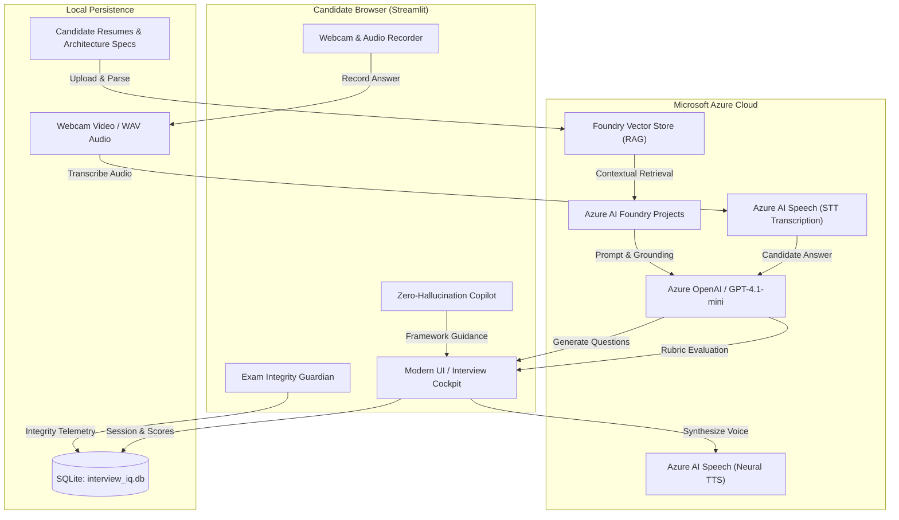

# 🎯 Interview IQ — Autonomous Multimodal AI Interview Coach

[](https://www.python.org/downloads/)
[](https://streamlit.io)
[](https://ai.azure.com/)
[](https://azure.microsoft.com/services/cognitive-services/speech-services/)
[](LICENSE)

> **Interview IQ** is an enterprise-grade, multimodal AI interview platform powered by **Microsoft Azure AI Foundry** and **Azure AI Speech**. Designed to simulate high-stakes Tier-1 engineering loops, it evaluates candidates across technical depth, system architecture trade-offs, and communication under realistic pressure.

---

## 📽️ Demo Showcase Video

A complete 1-minute 1080p demo showcase video with studio-grade **48 kHz stereo neural voiceover** is included with this project:
- 🎬 **Video File:** [`interview_iq_demo_showcase.mp4`](interview_iq_demo_showcase.mp4)
- 📖 **Demo Guide & Scene Breakdown:** [demo_video_guide.md](demo_video_guide.md)

---

## 🌟 Key Features & Innovations

### 1. 📄 Dynamic RAG Grounding (Azure AI Foundry Vector Stores)
- Index candidate resumes (`.pdf`, `.docx`) or system architecture specs directly into **Azure AI Foundry Vector Stores**.
- Formulates laser-targeted, grounded interview loops that test whether candidate answers match their actual experience.

### 2. 🎙️ Human-Parity Neural Voice (Azure AI Speech)
- **Neural Text-to-Speech (TTS):** Questions are voiced naturally using studio neural voices (`en-US-JennyNeural`, `en-US-AndrewMultilingualNeural`) with zero latency.
- **Speech-to-Text (STT):** Candidates can speak their answers with real-time audio transcription.

### 3. 📹 Proctored Video Answers & Exam Integrity Guardian
- In-browser candidate webcam capture for realistic technical and behavioral simulations.
- **Real-Time Exam Integrity Guardian:** Continuously monitors for window unfocus events and multiple face presence, generating proctoring compliance logs.

### 4. 📊 Tier-1 Rubric Scoring Telemetry
- Answers are evaluated on a structured, multi-dimensional rubric rather than generic feedback:
  - **Technical Depth & Accuracy** (0–100)
  - **System Architecture Trade-offs & Scalability** (0–100)
  - **STAR Methodology Delivery & Clarity** (0–100)
- Identifies specific technical strengths, unaddressed failure modes, and concrete growth vectors.

### 5. 🤖 Zero-Hallucination In-Interview Copilot
- Candidates can open an in-interview copilot modal when stuck on complex system architecture or behavioral questions.
- Strictly bounded prompt guardrails provide structured frameworks (e.g., STAR, CAP theorem trade-offs, capacity estimation formulas) **without leaking direct answers or solutions**.

### 6. 📈 Executive Hiring Dossier & Replay
- End-of-interview report with comprehensive performance synthesis, question-by-question scoring telemetry, hire/no-hire recommendations, and recorded video playback.

### 7. 🎯 Curated Benchmark Tracks
- Pre-configured interview tracks for instant practice:
  - **Distributed Systems & Scalability**
  - **Staff Machine Learning Engineering**
  - **Cloud Infrastructure & Reliability (SRE)**
  - **Engineering Leadership & Behavioral**

---

## 🏗️ Architecture & Data Flow



---

## 📁 Project Directory Structure

```text
AI103/
├── app.py                           # Main Streamlit application & interactive dashboard
├── requirements.txt                 # Python dependencies
├── .env.example                     # Environment variables template
├── test_connection.py               # Diagnostic test for Azure Foundry & Speech credentials
├── test_integration.py              # Full end-to-end automated pipeline test
├── interview_iq_demo_showcase.mp4   # 1080p showcase demo video (48kHz stereo voiceover)
├── demo_video_guide.md              # Scene breakdown & LinkedIn publishing guide
├── database/
│   └── interview_iq.db              # SQLite persistence for sessions, candidates, and telemetry
├── services/
│   ├── copilot_service.py           # Zero-hallucination in-interview copilot service
│   ├── db_service.py                # Database queries and session management
│   ├── document_service.py          # PDF / DOCX resume parsing and text extraction
│   ├── foundry_service.py           # Azure AI Foundry project client & vector store RAG
│   ├── interview_service.py         # Question orchestration & multi-dimensional evaluation
│   ├── recording_service.py         # Webcam recording & proctoring integrity guardian
│   └── speech_service.py            # Azure AI Speech TTS & STT integration
├── utils/
│   └── helpers.py                   # Formatting helpers, badge components, and styling
└── scratch/                         # Video generation scripts, audio assets & test scripts
```

---

## ⚙️ Prerequisites

1. **Python 3.10+** installed.
2. **FFmpeg** installed and accessible in your system `PATH` (used for audio extraction and video processing):
   - **Windows (via winget):**
     ```powershell
     winget install Gyan.FFmpeg
     ```
   - **macOS (via Homebrew):**
     ```bash
     brew install ffmpeg
     ```
   - **Linux (Ubuntu/Debian):**
     ```bash
     sudo apt update && sudo apt install ffmpeg
     ```
3. **Microsoft Azure Account:**
   - Active **Azure AI Foundry Project** with a deployed model (e.g., `gpt-4.1-mini` or `gpt-4o`).
   - Active **Azure AI Speech** resource (Key and Region).

---

## 🚀 Quickstart Guide

### 1. Clone the Repository
```bash
git clone https://github.com/aditya-650/-AI-Interview-Coach.git
cd -AI-Interview-Coach
```

### 2. Set Up a Virtual Environment
```bash
# Windows
python -m venv venv
.\venv\Scripts\activate

# macOS / Linux
python3 -m venv venv
source venv/bin/activate
```

### 3. Install Dependencies
```bash
pip install -r requirements.txt
```

### 4. Configure Environment Variables
Copy `.env.example` to `.env`:
```bash
cp .env.example .env
```
Edit `.env` and fill in your Azure credentials:
```env
# Microsoft Foundry Configuration
FOUNDRY_PROJECT_ENDPOINT=https://<your-foundry-resource>.services.ai.azure.com/api/projects/<your-project-name>
FOUNDRY_MODEL=gpt-4.1-mini
FOUNDRY_AGENT_NAME=AI-Interview-Coach

# Azure AI Speech Configuration
AZURE_SPEECH_KEY=<your-azure-speech-resource-key>
AZURE_SPEECH_REGION=<your-azure-speech-region>
```

---

## 🧪 Verification & Diagnostics

Run the automated diagnostic scripts to verify your connections before launching:

### 1. Diagnostic Health Check
Validates Azure Identity, Foundry Agent connectivity, and Azure Speech credentials:
```bash
python test_connection.py
```

### 2. End-to-End Pipeline Integration Test
Performs a mock resume upload, vector search grounding, speech transcription, answer rubric evaluation, and report synthesis:
```bash
python test_integration.py
```

---

## 🖥️ Running the Application

Launch the Streamlit web dashboard:
```bash
streamlit run app.py
```
Open your browser and navigate to:
```text
http://localhost:8501
```

### Navigating the Platform
1. **Landing Page:** Explore platform overview, live telemetry, and recent benchmark statistics.
2. **Benchmark Tracks:** Select a pre-calibrated track (e.g., *Staff ML*, *Distributed Systems*) or upload your own resume.
3. **Setup Cockpit:** Enter candidate details, select difficulty level, and index grounding documents into Azure Vector Stores.
4. **Live Interview Cockpit:**
   - Listen to the question voiced aloud via Azure Neural TTS.
   - Choose your submission format: **Text Input**, **Audio Voice**, or **Proctored Webcam Video**.
   - If stuck, open the **AI Copilot** for STAR hints and system design frameworks.
5. **Real-Time Evaluation:** Review instant rubric feedback on technical rigor, system trade-offs, and STAR delivery.
6. **Executive Dossier:** View the final comprehensive hire recommendation report and review recorded answer videos.

---

## 🔒 Security & Proctoring Integrity

- **Exam Integrity Guardian:** Tracks window unfocus/blur events and browser tab changes during timed video answers.
- **Privacy First:** Video recordings are stored locally and candidate resumes are processed in tenant-isolated Azure Foundry Vector Stores.
- **Zero Direct Leakage:** The in-interview copilot incorporates strict system prompts preventing it from providing complete answers to active questions.

---

## 📄 License

This project is licensed under the [MIT License](LICENSE).